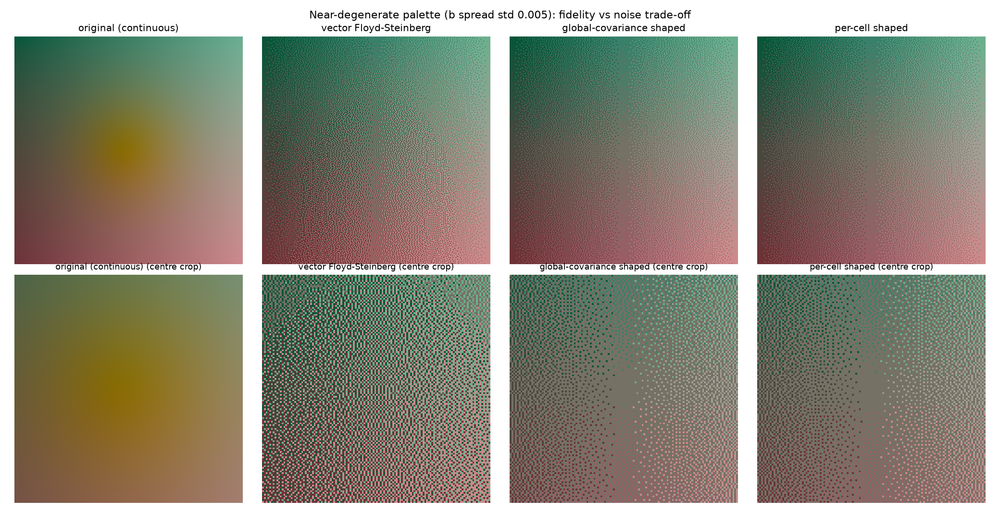
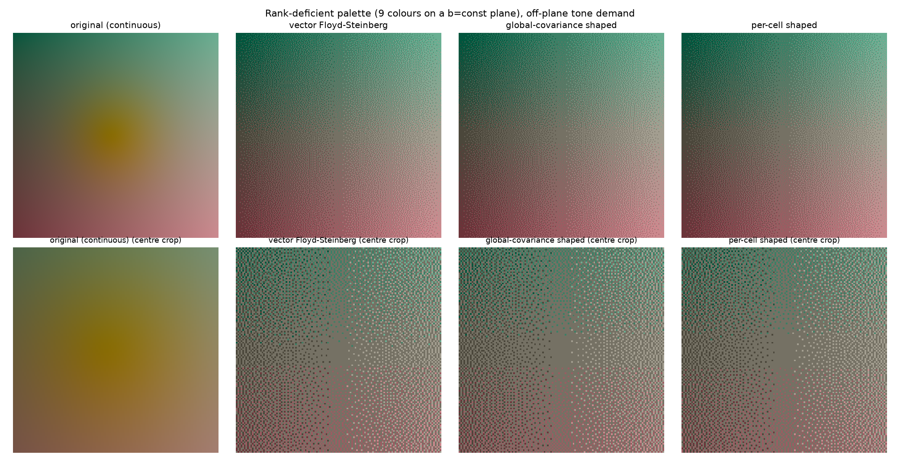
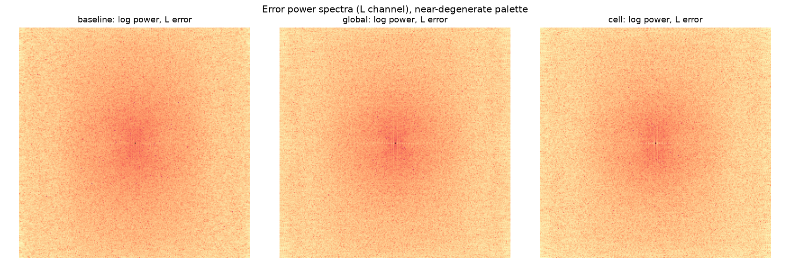

# Gallery

_A synthetic test image dithered against a palette that is almost, but not exactly, confined to a single plane in Oklab. Left to right: the continuous original, vector Floyd-Steinberg, global-covariance shaping, and per-cell shaping. The centre crop below each panel shows the effect most clearly: the baseline’s noise in the lightness channel is visibly coarser than the shaped variants’._

This is the pathological case for the method: the palette is not exactly rank-deficient, so shaping does discard something. On this test, the baseline recovers slightly more of the off-plane tone (the soft light patch near the centre) at the cost of 1.7 times higher lightness noise. Whether that trade is worth making depends on the image and the palette; the epsilon parameter is what tunes it. See docs/for-designers.md for how to think about that trade-off, and docs/mathematical-appendix.md for where the 1.7 times figure comes from.

## The null result, shown honestly

_The same layout, but the palette here is exactly confined to a single plane in Oklab by construction (nine colours, all with the same Oklab b). All three variants produce the same output. This is not a bug: it is the inertness lemma. Error orthogonal to a palette’s affine hull adds identical squared distance to every candidate under nearest-neighbour quantisation, so no shaping matrix can change which colour gets picked. Shaping has nothing to do here because there is nothing unpayable to protect against; the palette’s own geometry already prevents that error from doing any harm._

## Error spectra

_Log power spectra of the lightness-channel error, near-degenerate palette. Diffusion that cannot shed unpayable error tends to leave more energy at low spatial frequency, visible here as extra concentration near the centre of the spectrum for the baseline compared with the shaped variants. This is the spectral signature behind the noise-standard-deviation numbers above; it is a subtle effect at this scale, which is itself worth stating plainly rather than overselling._

## Regenerating these images

All three images are produced by `python gallery/generate_gallery.py`, using only `tramage`’s public API on synthetic, exactly reproducible test cases (no external photograph is required). Running it again from a fresh checkout reproduces these files exactly.

A note on the per-cell panel: it is shown here for completeness alongside the global variant, because the gallery is the historical record of the method's development. A Kodak24 corpus run (see [`../experiments/dithering_quality/`](../experiments/dithering_quality/README.md)) has since found that the per-cell variant matches the global one on noise but loses on tone accuracy and the worm metric from K=16 onward, so the **recommended method is the global variant alone**; `per_cell_shaping_matrices` is kept in the package as an explored extension, not as an endorsed second choice.
